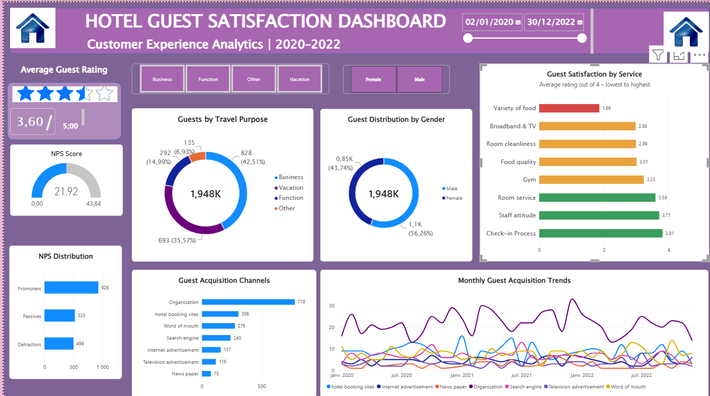
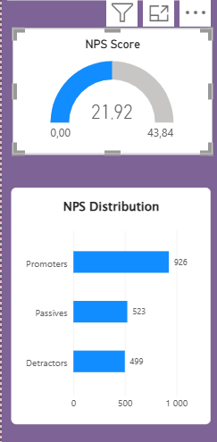
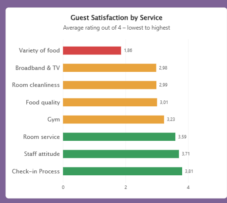
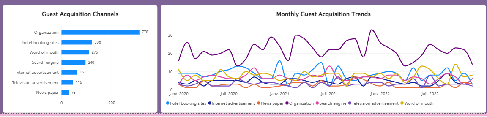

# Hotel Guest Satisfaction Dashboard

**Power BI | Data Analytics | Business Intelligence**

## Project Overview

This project analyzes **1,948 hotel guest feedback records from 2020 to 2022** to assess customer satisfaction, identify service improvement opportunities, and support data-driven decisions.

I developed an interactive **Power BI dashboard** to explore overall ratings, Net Promoter Score (NPS), service performance, guest profiles, and acquisition channels.

## Dashboard Overview



## Business Objectives

- Monitor overall guest satisfaction and customer loyalty.
- Calculate and interpret the Net Promoter Score (NPS).
- Identify the highest- and lowest-rated hotel services.
- Understand guest profiles and travel purposes.
- Analyze guest acquisition channels and monthly trends.
- Translate findings into actionable business recommendations.

## Tools & Technologies

| Tool | Purpose |
|---|---|
| Power BI Desktop | Interactive dashboard design and reporting |
| DAX | KPI calculations and NPS measures |
| Microsoft Excel | Source dataset |
| Power Query | Data preparation and transformation |

## Dataset

The dataset contains **1,948 guest feedback records** covering **2020–2022**. It includes guest demographics, travel purposes, satisfaction ratings, NPS recommendation scores, hotel service evaluations, acquisition channels, and feedback dates.

- **Dataset file:** [`data/Customer-Feedback-Dashboard-Data.xlsx`](data/Customer-Feedback-Dashboard-Data.xlsx)


## Key Performance Indicators

| KPI | Result |
|---|---:|
| Total Guest Responses | 1,948 |
| Average Guest Rating | 3.60 / 5 |
| Net Promoter Score (NPS) | +21.92 |
| Promoters | 926 |
| Passives | 523 |
| Detractors | 499 |

## 1. Net Promoter Score Analysis



NPS measures how likely guests are to recommend the hotel. Respondents are grouped as follows:

- **Promoters:** Scores of 9–10
- **Passives:** Scores of 7–8
- **Detractors:** Scores of 0–6

**Formula:**

```text
NPS = (% Promoters) - (% Detractors)
    = (926 / 1,948 × 100) - (499 / 1,948 × 100)
    = +21.92
```

**Insight:** The positive NPS indicates more promoters than detractors. However, the **499 detractors** suggest opportunities to improve the guest experience.

## 2. Hotel Service Satisfaction Analysis



The dashboard compares average satisfaction ratings across hotel services.

| Service | Average Rating |
|---|---:|
| Check-in Process | 3.81 / 4 |
| Staff Attitude | 3.71 / 4 |
| Room Service | 3.59 / 5 |
| Gym | 3.23 / 4 |
| Food Quality | 3.01 / 4 |
| Room Cleanliness | 2.99 / 4 |
| Broadband & TV | 2.98 / 4 |
| Variety of Food | 1.86 / 4 |

**Insight:** Check-in and staff attitude are relatively strong service areas, while **Variety of Food** is the lowest-rated dimension and deserves further investigation.

## 3. Guest Acquisition Analysis



The dashboard explores how guests discovered the hotel and how acquisition patterns changed over time.

| Acquisition Channel | Guest Responses |
|---|---:|
| Organization | 778 |
| Hotel Booking Sites | 306 |
| Word of Mouth | 276 |
| Search Engine | 240 |
| Internet Advertisement | 157 |
| Television Advertisement | 116 |
| Newspaper | 75 |

**Insight:** **Organization** is the most frequently reported acquisition channel. Its importance suggests an opportunity to investigate organizational partnerships and compare the effectiveness of different channels.

## Business Recommendations

1. **Improve food variety:** Investigate guest preferences and identify ways to expand or adapt meal options.
2. **Maintain service strengths:** Preserve the performance of check-in and staff interactions.
3. **Investigate detractor feedback:** Explore factors associated with low recommendation scores.
4. **Monitor satisfaction over time:** Track NPS and service ratings to evaluate improvements.
5. **Review acquisition strategy:** Compare channels and guest segments before deciding where to invest marketing resources.

## Repository Structure

```text
hotel-guest-satisfaction-dashboard/
├── README.md
├── .gitignore
├── data/
│   └── Customer-Feedback-Dashboard-Data.xlsx
├── dashboard/
│   └── Hotel_Guest_Satisfaction_Dashboard.pbix
└── images/
    ├── dashboard-overview.png
    ├── nps-analysis.png
    ├── service-satisfaction.png
    └── acquisition-trends.png
```

## How to Explore the Dashboard

1. Clone or download this repository.
2. Open [`dashboard/Hotel_Guest_Satisfaction_Dashboard.pbix`](dashboard/Hotel_Guest_Satisfaction_Dashboard.pbix) using **Power BI Desktop**.
3. If needed, update the Excel source file path to point to the dataset in `data/`.
4. Refresh the data and explore the report's interactive visuals and filters.

## Skills Demonstrated

- Data analysis and business intelligence
- Power BI dashboard development
- DAX measures and KPI design
- Customer satisfaction and NPS analysis
- Data visualization and storytelling
- Business insights and recommendations

